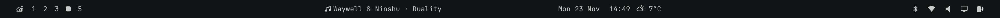

# Gary plugins

These are Sander's plugins for [Gary](https://github.com/sndrgrdn/gary), a macOS shell that you extend with TypeScript plugins. They need Gary 0.3.1 or later, which finds the files a plugin ships relative to its folder. Dinky and Weather are written with Effect, so they need a Gary that provides `gary:effect`.



- [`sndrgrdn.battery`](sndrgrdn.battery) shows the battery level in the bar.
- [`sndrgrdn.clock`](sndrgrdn.clock) shows the date and time in the bar.
- [`sndrgrdn.control-center`](sndrgrdn.control-center) opens Wi‑Fi, Bluetooth, Focus, volume and brightness controls from the bar, and shows a pill when you press the volume or brightness keys.
- [`sndrgrdn.dinky`](sndrgrdn.dinky) shows the workspaces of the [dinky](https://github.com/mikker/Dinky) window manager in the bar.
- [`sndrgrdn.front-app`](sndrgrdn.front-app) shows the name and icon of the app that dinky reports as focused. It needs `sndrgrdn.dinky` and an `app-icon` font in `~/.config/gary/theme.json`, such as `sketchybar-app-font`.
- [`sndrgrdn.theme`](sndrgrdn.theme) switches between the Omarchy themes of [theme-switcher](https://github.com/sndrgrdn/theme-switcher) from a menu, and applies the theme to Gary, the wallpaper, and several apps.
- [`sndrgrdn.weather`](sndrgrdn.weather) shows the weather from [Open-Meteo](https://open-meteo.com) in the bar. It shows Leeuwarden unless you set `latitude` and `longitude` in its settings.

## Install

Clone the repository:

```sh
git clone https://github.com/sndrgrdn/gary-plugins.git
```

To use all the plugins and edit them in place, link the clone as your plugin folder:

```sh
ln -s "$PWD/gary-plugins" ~/.config/gary/plugins
```

The link works only when `~/.config/gary/plugins` does not exist yet. Gary loads every plugin in the folder. Turn on each plugin that you want with `gary plugin enable <id>`.

To install the plugins as a package instead, which `gary plugin update` keeps up to date:

```sh
gary plugin install git:github.com/sndrgrdn/gary-plugins
```

## License

The plugins are released under the [MIT License](LICENSE).
