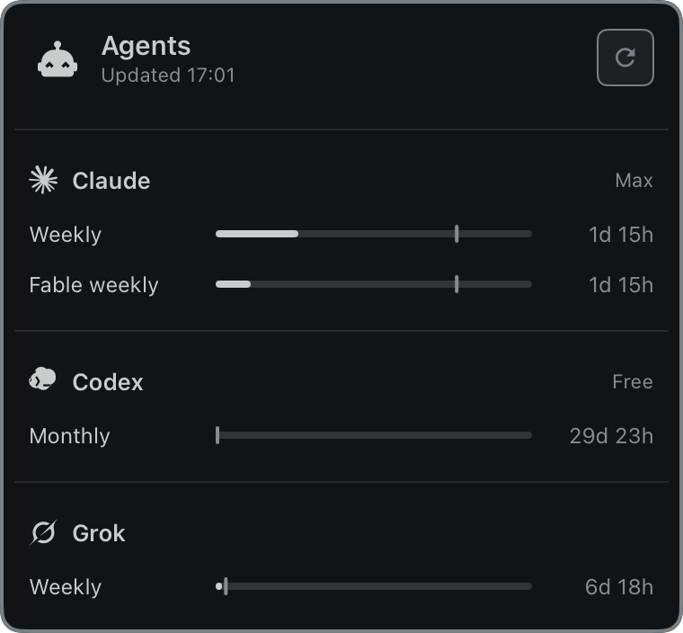

# Agents

Shows how much of your Claude, Codex and Grok subscription limits you have used, in a panel like Omarchy's agents panel.



- The bar shows a robot glyph. It turns red when a limit is at 90% or more.
- Click it to open the panel. Each agent has its plan and one row per limit: a meter of how much you have used and the time until it resets. Rest the pointer on a row for the exact percentage.
- Claude's model limits, such as Fable's weekly limit, have rows of their own.
- A dim tick on each meter marks an even pace: how much of the limit you would have used by now if you spread it evenly until it resets. A fill past the tick means you are over pace. The row's tooltip gives the difference and, when you would run out before the reset, when that happens.
- The panel refreshes every 5 minutes, when you open it, and when you click its refresh button.
- When an agent cannot be checked, the panel says why and keeps its last numbers. A red "Sign-in required" means you have to sign in again.

When a Claude or Grok token has expired, the plugin refreshes it and saves the new one where that CLI keeps it, so the CLI goes on working with it. It never signs in, and it keeps tokens out of the log and its topic.

- **Claude**: the plugin refreshes only while it holds Claude Code's own refresh lock, `~/.claude/.oauth_refresh.lock`, so it never races Claude Code. It saves the new token with `security -i`, which reads it from a file in that lock folder rather than from the command line. When Claude Code's credentials are too large for `security -i`, it passes them on the command line instead, as Claude Code does.
- **Grok**: the plugin refreshes through the issuer in `~/.grok/auth.json` and writes the new token back to that file, which grok picks up on its next request.

## Where the numbers come from

- **Claude**: the Claude Code token from the `Claude Code-credentials` keychain item, read with `security`, sent to Anthropic's `api/oauth/usage` endpoint.
- **Codex**: `codex app-server`, asked for `account/rateLimits/read` over JSON-RPC. Each check takes about half a second.
- **Grok**: the token in `~/.grok/auth.json`, sent to grok's `v1/billing` endpoint.

The plugin has three parts. A service checks the three agents at once and publishes them as the `sndrgrdn.agents` topic. The bar widget and the panel draw that topic, and the panel asks the service to refresh. `gary call sndrgrdn.agents state` prints what the service knows, and `gary call sndrgrdn.agents refresh` checks again.

## Setup

- Use a Gary newer than 0.4.0, whose `fetch` sends headers. Gary 0.4.0 sends none, so Claude and Grok show "Sign-in required".
- Sign in to Claude Code with `claude auth login`, to Codex with `codex login`, and to grok with `grok login`. You sign in again only when a CLI's sign-in itself expires.
- Use a Nerd Font for the bar, such as `JetBrainsMono Nerd Font`, so the glyph shows.

## Credits

The layout and the Claude, Codex and Grok marks in `assets` come from the agents panel of [Omarchy](https://github.com/basecamp/omarchy), under Omarchy's MIT License.

## Install

This plugin ships in the `sndrgrdn/gary-plugins` package. Installing the package adds every plugin in it:

```sh
gary plugin install git:github.com/sndrgrdn/gary-plugins
```

To use only this plugin, turn the others off with `gary plugin disable <id>`.

## Develop

Gary reloads the plugin each time you save an entry file. It uses Effect from `gary:effect`. Run `npm install` once at the repository root for the `effect` types, then type-check it with `npx tsc -p .`.
After you change `uses` or `subscribes` in `manifest.json`, run `gary plugin types .` to refresh `gary.d.ts`.
