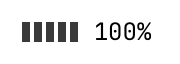

# Battery

Shows the battery level in the bar as five segments and a percentage.



- Each segment stands for 20%, so 61% fills four.
- The segments turn `green` while the Mac is on power and `red` at 20% or less. Otherwise they use `foreground`. All three are colors from your theme.
- On a Mac without a battery the widget shows nothing.

It reads Gary's `battery` topic and needs no permissions or settings.

## Install

This plugin ships in the `sndrgrdn/gary-plugins` package. Installing the package adds every plugin in it:

```sh
gary plugin install git:github.com/sndrgrdn/gary-plugins
```

To use only this plugin, turn the others off with `gary plugin disable <id>`.

## Develop

Gary reloads the plugin each time you save an entry file. Type-check it with `npx -p typescript tsc -p .`.
After you change `uses` or `subscribes` in `manifest.json`, run `gary plugin types .` to refresh `gary.d.ts`.
