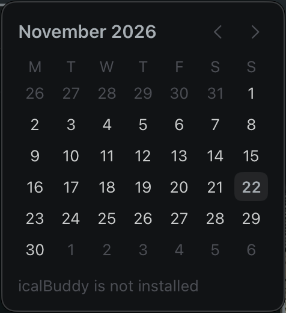

# Calendar

Shows the date and the time in the bar, like [Clock](../sndrgrdn.clock). Click it to open a month calendar with today's events.



- The bar widget looks the same as Clock, so put it in Clock's place instead of next to it.
- Scroll over the calendar, or click the arrows, to change the month. Click the month name to go back to today.
- Click the clock again to close the calendar.
- Today's events come from [icalBuddy](https://hasseg.org/icalBuddy/), which reads the calendars in macOS Calendar. They refresh every 5 minutes and when the day changes. Without icalBuddy the calendar shows only the month.

The plugin has three parts. A service runs `icalBuddy eventsToday` and publishes the events as the `sndrgrdn.calendar` topic. The bar widget shows the clock, and the panel draws the month and the events from that topic. `gary call sndrgrdn.calendar refresh` reads the events again and prints them.

## Setup

- Install icalBuddy so it's on your `PATH`, such as with `brew install ical-buddy`.
- Replace `sndrgrdn.clock` with `sndrgrdn.calendar` in `bar.right` in `~/.config/gary/shell.json`.

## Install

This plugin ships in the `sndrgrdn/gary-plugins` package. Installing the package adds every plugin in it:

```sh
gary plugin install git:github.com/sndrgrdn/gary-plugins
```

To use only this plugin, turn the others off with `gary plugin disable <id>`.

## Develop

Gary reloads the plugin each time you save an entry file. It uses Effect from `gary:effect`. Run `npm install` once at the repository root for the `effect` types, then type-check it with `npx tsc -p .`.
After you change `uses` or `subscribes` in `manifest.json`, run `gary plugin types .` to refresh `gary.d.ts`.
