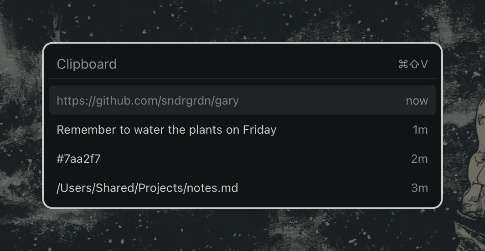

# Clipboard

Keeps a history of the text, images and files you copy, and pastes an earlier entry into the app you were in.



- Press ⌘⇧V to open the history. Escape or a click outside closes it.
- ↑ and ↓ move the selection. Return pastes the selected entry into the app you came from, and ⌫ removes it from the history.
- Click an entry to paste it, or right-click it to remove it.
- The history keeps the 50 newest entries and survives restarts. Copying an entry again moves it to the top.
- It skips text over 100,000 characters, and anything that a password manager marks as concealed or transient.
- Gary saves a copied image as a PNG in the temporary folder, so macOS can delete it after a few days. Pasting an image whose file is gone fails, and the log says so.

The plugin has two parts. A service watches the clipboard, keeps the history in Gary's storage, and publishes it as the `sndrgrdn.clipboard` topic. The menu draws that topic, and asks the service to paste or remove an entry.

## Setup

Pasting needs Accessibility for Gary. Run `gary permissions request accessibility` and allow it in System Settings.

⌘⇧V replaces the shortcut that some apps use for Paste and Match Style. To use another key, change `keys` under `hotkeys` in `manifest.json`.

Name a Nerd Font `icon` in `~/.config/gary/theme.json`. The menu's file icon is one of its glyphs:

```json
{ "fonts": { "icon": { "family": "JetBrainsMono Nerd Font", "size": 13, "weight": "regular" } } }
```

## Install

This plugin ships in the `sndrgrdn/gary-plugins` package. Installing the package adds every plugin in it:

```sh
gary plugin install git:github.com/sndrgrdn/gary-plugins
```

If you installed the package before this plugin existed, run `gary plugin update` and then `gary plugin enable sndrgrdn.clipboard`.

To use only this plugin, turn the others off with `gary plugin disable <id>`.

## Develop

Gary reloads the plugin each time you save an entry file. The service uses Effect from `gary:effect`. Run `npm install` once at the repository root for the `effect` types, then type-check it with `npx tsc -p .`.
After you change `uses` or `subscribes` in `manifest.json`, run `gary plugin types .` to refresh `gary.d.ts`.
