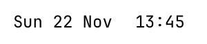

# Clock

Shows the date and the time in the bar, such as `Sun 22 Nov  13:45`. Click it to open a month calendar with today's events.



- The time uses the 24-hour clock and updates every minute.
- The time has a fixed width, so the widgets next to it don't shift when the minutes change.
- Scroll over the calendar, or click the arrows, to change the month. Click the month name to go back to today.
- Click the clock again to close the calendar.
- Today's events come from the calendars in the macOS Calendar app. They refresh when an event changes and when the day changes.

The calendar panel reads Gary's `calendar` capability, which needs the Calendars permission. Without it, the calendar shows only the month and the reason. `gary permissions request calendars` asks for it.

## Settings

Set `format` in `~/.config/gary/shell.json` to show the clock in one line in another format. Omarchy's format shows `Sunday 19:18`:

```json
{ "settings": { "sndrgrdn.clock": { "format": "dddd HH:mm" } } }
```

The format takes Omarchy's date tokens:

| Token | Shows |
| --- | --- |
| `dddd`, `ddd` | The day's name, such as `Sunday`, or `Sun` |
| `dd`, `d` | The day of the month, such as `08`, or `8` |
| `MMMM`, `MMM` | The month's name, such as `November`, or `Nov` |
| `MM`, `M` | The month's number, such as `03`, or `3` |
| `yyyy` | The year |
| `HH`, `H` | The hour on the 24-hour clock, such as `09`, or `9` |
| `mm` | The minutes |

Any other character shows as itself. Put text in single quotes to keep its letters from being read as tokens, such as `ddd d MMM 'at' HH:mm` for `Sun 22 Nov at 19:18`. Without `format`, the clock shows `Sun 22 Nov  13:45`, with the time brighter than the date.

## Install

This plugin ships in the `sndrgrdn/gary-plugins` package. Installing the package adds every plugin in it:

```sh
gary plugin install git:github.com/sndrgrdn/gary-plugins
```

To use only this plugin, turn the others off with `gary plugin disable <id>`.

## Develop

Gary reloads the plugin each time you save an entry file. The panel uses Effect from `gary:effect`. Run `npm install` once at the repository root for the `effect` types, then type-check it with `npx tsc -p .`.
After you change `uses` or `subscribes` in `manifest.json`, run `gary plugin types .` to refresh `gary.d.ts`.
