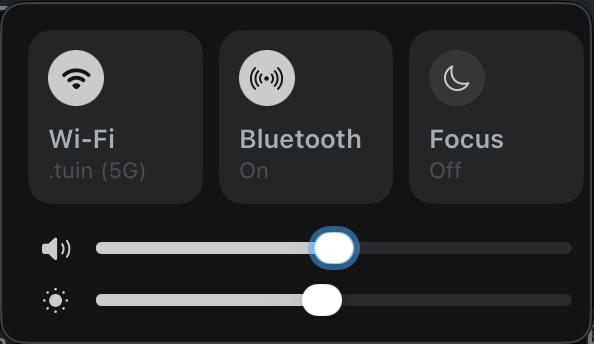

# Control Center

An icon in the bar opens tiles for Wi‑Fi, Bluetooth and Focus, with sliders for volume and brightness. The plugin also takes over the volume and brightness keys and shows their level in a pill near the bottom of the screen.




## Use

- Click the icon in the bar to open the menu. Escape or a click outside closes it.
- Click the Wi‑Fi or Bluetooth tile to turn it on or off.
- Right-click the Wi‑Fi tile for the networks nearby. Click one to join it. If it needs a password you haven't saved, a password field opens below it.
- Right-click the Bluetooth tile for your paired devices. Click one to connect or disconnect it.
- The Focus tile shows the current Focus. Gary can read Focus but not change it.
- The volume, mute and brightness keys change the level in steps of 1/16, like macOS, and show the pill. It fades 1.5 seconds after the last press.

## Permissions

- Wi‑Fi network names need Location.
- Bluetooth needs Bluetooth.
- Focus needs Full Disk Access.
- Taking over the media keys needs Accessibility.

`gary onboarding` lists what is missing, with an Allow button for each.

## Install

This plugin ships in the `sndrgrdn/gary-plugins` package. Installing the package adds every plugin in it:

```sh
gary plugin install git:github.com/sndrgrdn/gary-plugins
```

To use only this plugin, turn the others off with `gary plugin disable <id>`.

## Develop

Gary reloads the plugin each time you save an entry file. It uses Effect from `gary:effect`. Run `npm install` once at the repository root for the `effect` types, then type-check it with `npx tsc -p .`.
After you change `uses` or `subscribes` in `manifest.json`, run `gary plugin types .` to refresh `gary.d.ts`.
