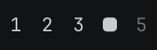

# Dinky

Shows the workspaces of the [dinky](https://github.com/mikker/Dinky) window manager in the bar, one row per display.



- The focused workspace shows a glyph for its layout: 󰝥 for scrolling and 󱓻 for every other layout. The others show their number.
- Empty workspaces are dimmed.
- Click a workspace to switch to it.
- Each display shows only its own workspaces.

The plugin has two parts. A service asks the `dinky` command for the workspaces and the focused app, and publishes them as the `sndrgrdn.dinky` topic. The bar widget draws that topic. [Front App](../sndrgrdn.front-app) and [Theme](../sndrgrdn.theme) read it too.

## Setup

- Install `dinky` so it's on your `PATH`.
- Use a Nerd Font for the bar, such as `JetBrainsMono Nerd Font Mono`, so the layout glyphs show.
- Tell dinky to notify the plugin. Add these hooks to `~/.config/dinky/dinky.toml`:

```toml
startup = ['exec-and-forget gary call sndrgrdn.dinky startup']
workspace-changing = ['exec-and-forget gary call sndrgrdn.dinky workspace-changing "$DINKY_DISPLAY" "$DINKY_WORKSPACE"']
workspace-changed = ['exec-and-forget gary call sndrgrdn.dinky workspace-changed']
focus-changed = ['exec-and-forget gary call sndrgrdn.dinky focus-changed']
display-changed = ['exec-and-forget gary call sndrgrdn.dinky display-changed']
```

`workspace-changing` highlights the new workspace right away, before dinky has finished switching. `gary call sndrgrdn.dinky state` prints what the service knows.

## Install

This plugin ships in the `sndrgrdn/gary-plugins` package. Installing the package adds every plugin in it:

```sh
gary plugin install git:github.com/sndrgrdn/gary-plugins
```

To use only this plugin, turn the others off with `gary plugin disable <id>`.

## Develop

Gary reloads the plugin each time you save an entry file. It uses Effect from `gary:effect`. Run `npm install` once at the repository root for the `effect` types, then type-check it with `npx tsc -p .`.
After you change `uses` or `subscribes` in `manifest.json`, run `gary plugin types .` to refresh `gary.d.ts`.
