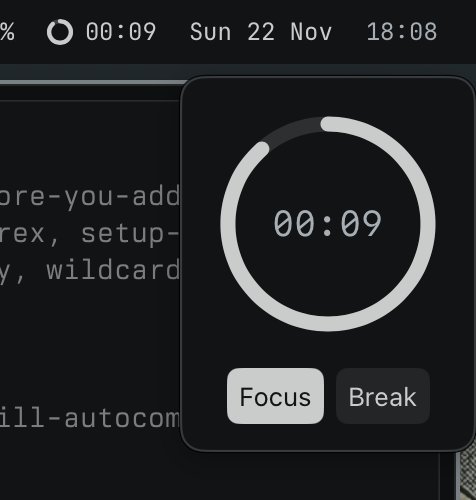

# Focus Timer

Counts down a focus or break session in the bar, with a ring that empties as time runs out.



- The bar shows the time left. Scroll over it to add or remove 5 minutes. Scrolling up with no session running starts a 5-minute focus session.
- Click it to open the panel. Focus starts 25 minutes and Break starts 5 minutes. Click the lit button again to stop.
- A sound plays when the session ends, through `afplay`.
- The end time is kept in Gary's storage, so a reload or a restart of Gary keeps the session.

The plugin has three parts. A service owns the session, plays the sound, and publishes the session as the `sndrgrdn.focus-timer` topic. The bar widget and the panel draw that topic and send changes to the service.

## Settings

Set the sound and its volume, from 0 to 1, in `~/.config/gary/shell.json`:

```json
{ "settings": { "sndrgrdn.focus-timer": { "sound": "/System/Library/Sounds/Hero.aiff", "volume": 0.5 } } }
```

The default is `Glass.aiff` at full volume.

## Commands

- `gary call sndrgrdn.focus-timer start focus` starts a focus session, and `start break` a break. A third argument sets the length in seconds.
- `gary call sndrgrdn.focus-timer add 5` adds 5 minutes, and `add -5` removes them.
- `gary call sndrgrdn.focus-timer stop` stops the session.

Each prints the session, or `null` when none is running.

## Install

This plugin ships in the `sndrgrdn/gary-plugins` package. Installing the package adds every plugin in it:

```sh
gary plugin install git:github.com/sndrgrdn/gary-plugins
```

To use only this plugin, turn the others off with `gary plugin disable <id>`.

## Develop

Gary reloads the plugin each time you save an entry file. It uses Effect from `gary:effect`. Run `npm install` once at the repository root for the `effect` types, then type-check it with `npx tsc -p .`.
After you change `uses` or `subscribes` in `manifest.json`, run `gary plugin types .` to refresh `gary.d.ts`.
