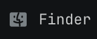

# Front App

Shows the icon and name of the focused app in the bar.



- It takes the app from [Dinky](../sndrgrdn.dinky), so it follows dinky's focus rather than the macOS menu bar.
- The icon is a glyph from `sketchybar-app-font`. `app_icons.tsv` maps app names to glyphs. A name that ends in `*` matches every app that starts with it, and the line without a name is the fallback.
- When no app has focus, the widget shows nothing.

## Setup

- Turn on `sndrgrdn.dinky` and set it up first.
- Install [sketchybar-app-font](https://github.com/kvndrsslr/sketchybar-app-font) and name it `app-icon` in `~/.config/gary/theme.json`:

```json
{ "fonts": { "app-icon": { "family": "sketchybar-app-font", "size": 14 } } }
```

## Install

This plugin ships in the `sndrgrdn/gary-plugins` package. Installing the package adds every plugin in it:

```sh
gary plugin install git:github.com/sndrgrdn/gary-plugins
```

To use only this plugin, turn the others off with `gary plugin disable <id>`.

## Develop

Gary reloads the plugin each time you save an entry file. Type-check it with `npx -p typescript tsc -p .`.
After you change `uses` or `subscribes` in `manifest.json`, run `gary plugin types .` to refresh `gary.d.ts`.
