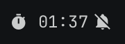

# Indicators

Shows small icons in the bar while something is on, like the indicators next to Omarchy's clock. With nothing on, it draws nothing, though Gary still keeps the bar's gap between widgets for it.



- **Screen recording**, a record icon, while `sndrgrdn.menu` records the screen.
- **Focus timer**, a stopwatch and the time left, while a `sndrgrdn.focus-timer` session runs. A break shows a cup instead of the stopwatch.
- **Focus**, Omarchy's Do Not Disturb bell, while a macOS Focus is on. Its name shows in the tooltip.
- **Stay awake**, a steaming cup, while `sndrgrdn.menu` keeps the Mac awake.

The icons are Omarchy's Nerd Font glyphs, so the bar needs a Nerd Font, such as `JetBrainsMono Nerd Font`. They show in that order. Each has a tooltip, but clicking does nothing, because a Gary plugin cannot open another plugin's panel or call its methods.

It reads the `sndrgrdn.focus-timer` and `sndrgrdn.menu` topics, so those plugins must be enabled for their indicators to show. The Focus indicator reads Gary's `focus` topic, which needs Full Disk Access. `gary permissions request full-disk-access` opens its pane.

Place it before the clock in `~/.config/gary/shell.json`:

```json
{ "bar": { "center": ["sndrgrdn.indicators", "sndrgrdn.clock"] } }
```

## Install

This plugin ships in the `sndrgrdn/gary-plugins` package. Installing the package adds every plugin in it:

```sh
gary plugin install git:github.com/sndrgrdn/gary-plugins
```

To use only this plugin, turn the others off with `gary plugin disable <id>`.

## Develop

Gary reloads the plugin each time you save an entry file. It uses Effect from `gary:effect`. Run `npm install` once at the repository root for the `effect` types, then type-check it with `npx tsc -p .`.
After you change `uses` or `subscribes` in `manifest.json`, run `gary plugin types .` to refresh `gary.d.ts`.
