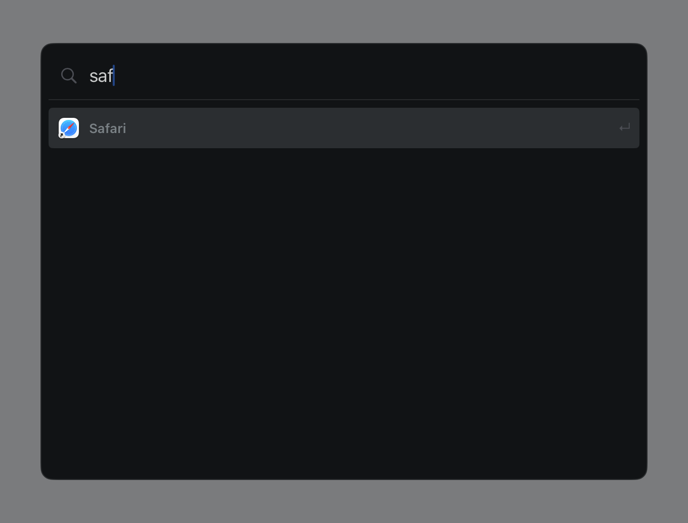

# Launcher

Opens apps from a picker, like [Walker](https://github.com/abenz1267/walker) in [Omarchy](https://github.com/basecamp/omarchy).



## Use

- **alt+space** opens the picker in the middle of the display under the pointer.
  - Type to fuzzy-match app names. "ghd" finds GitHub Desktop.
  - Up and down, or tab, move the selection.
  - Return opens the selected app, and so does a click.
  - Escape, or a click outside the picker, closes it.

The picker lists the apps that Gary finds in `/Applications`, `/System/Applications`, `~/Applications`, and the folders directly inside them, such as `Utilities`. It reads them when Gary loads it and again each time it opens, so typing never waits for the disk.

## Commands

```sh
gary call sndrgrdn.launcher open    # open the picker
gary call sndrgrdn.launcher state   # the app count, the query, and the first results
```

## Install

This plugin ships in the `sndrgrdn/gary-plugins` package. Installing the package adds every plugin in it:

```sh
gary plugin install git:github.com/sndrgrdn/gary-plugins
```

To use only this plugin, turn the others off with `gary plugin disable <id>`.

## Develop

Gary reloads the plugin each time you save a file in its folder. Type-check it with `npx tsc -p .`.
After you change `uses` or `subscribes` in `manifest.json`, run `gary plugin types .` to refresh `gary.d.ts`.
