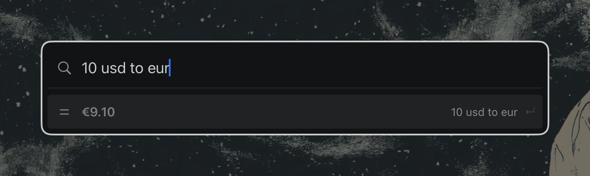

# Launcher

Opens apps and System Settings panes, and works out calculations, from a picker, like [Walker](https://github.com/abenz1267/walker) in [Omarchy](https://github.com/basecamp/omarchy).


## Use

- **alt+space**, or the `key` setting, opens the picker a quarter of the way down the display under the pointer.
  - Type to fuzzy-match app and settings pane names. "ghd" finds GitHub Desktop, and "keyb" finds the Keyboard pane.
  - Type a calculation, such as `20% of 50`, `5 ft to cm`, `10 usd to eur`, or `3pm london to new york`, and its answer shows above the apps.
  - Up and down, or tab, move the selection, and so does pointing at a row.
  - Return opens the selected app or pane, and so does a click. On the answer, Return copies it and closes the picker.
  - Escape, or a click outside the picker, closes it.

The picker lists Finder and the apps that Gary finds in `/Applications`, `/System/Applications`, `/System/Library/CoreServices/Applications`, `~/Applications`, and the folders directly inside them, such as `Utilities`. It reads them when Gary loads it and again each time it opens, so typing never waits for the disk.

The picker also lists the System Settings panes, such as Keyboard, Displays, and Privacy & Security, with the System Settings icon and a dim "System Settings" label. It finds them in `/System/Library/ExtensionKit/Extensions` when Gary loads it, keeps the list in Gary's storage, and shows the stored list until the new one is ready. It lists only the panes that System Settings opens by link, and opens one with `open x-apple.systempreferences:<pane id>`. When an app and a pane match equally well, the app comes first.

The picker learns from the apps and panes you open. Each one you open moves up the list, and the empty picker lists the ones you open most and most recently first. It also remembers what you typed to open an app, so after you open HyperKey with "h", "h" puts HyperKey first. A visit counts for less as it ages, halving every 10 days, and a remembered query counts until 17 days after you last open the app. The picker keeps these visits in Gary's storage for the plugin.

## Calculator



The calculator works out arithmetic, percentages, units, currencies, dates, time zones, and number bases. It shows an answer only when the query is clearly a calculation, so "42" or "firefox" shows apps only, and Return still opens the app.

Beyond what omacast reads on its own, the calculator understands these forms:

- A calculation that you are still typing. `2+` shows 2 and `(2+3` shows 5, so the answer row stays while you type.
- An amount on its own, which converts to a related unit. `5 km` shows miles, `1m` shows feet, `70 kg` shows pounds, `20 c` shows Fahrenheit, `180 cm` shows inches, and `2 L` shows gallons, and each converts back the other way. A currency amount such as `100 usd` or `£10` shows euros, and euros show US dollars.
- Data sizes in lowercase, such as `1 gb to mb` and `1 gib to mb`. A lowercase `b` means bytes, except in `bps`, which means bits per second, as in `100mbps to MB/s`.
- Number shorthand: `10k`, `1e3`, and an `x` between numbers to multiply, as in `3x3` or `1920x1080`.
- Questions and phrases: `5 km is how many miles`, `convert 5 km to miles`, `how many feet in a mile`, `15% tip on 42`, `half of 90`, and `5'10" to cm`. A tip shows the tip itself, not the total.

Currency conversions use the European Central Bank's reference rates from [Frankfurter](https://frankfurter.dev). The plugin fetches them from `api.frankfurter.dev` when Gary loads it, and again once they are more than 12 hours old. It keeps them in Gary's storage, so conversions work offline with the last rates. This request is the plugin's only network use.

## Settings

Set these in `~/.config/gary/shell.json`:

- `key`: the shortcut that opens the picker, written like `cmd+space` or `hyper+space`. It is `alt+space` by default. Quit any app that holds the same shortcut, such as Spotlight or another launcher, or Gary logs it as taken and leaves it unregistered.
- `minimal`: `true` opens the picker as the search field alone, and shows the list once you type. It is `false` by default.
- `rows`: how many rows the list shows before it scrolls, counting the calculator's answer as one. It is `9` by default.

```json
{ "settings": { "sndrgrdn.launcher": { "key": "cmd+space", "minimal": true, "rows": 5 } } }
```

## Commands

```sh
gary call sndrgrdn.launcher open    # open the picker
gary call sndrgrdn.launcher state   # the app and pane counts, the query, the answer, the rules that rewrote the query, and the first results
```

## Setup

Name a Nerd Font `icon` in `~/.config/gary/theme.json`. The search and calculator icons are its glyphs:

```json
{ "fonts": { "icon": { "family": "JetBrainsMono Nerd Font", "size": 13, "weight": "regular" } } }
```

## Install

This plugin ships in the `sndrgrdn/gary-plugins` package. Installing the package adds every plugin in it:

```sh
gary plugin install git:github.com/sndrgrdn/gary-plugins
```

To use only this plugin, turn the others off with `gary plugin disable <id>`.

## Credits

The calculator, the fuzzy ranking, and the visit scores come from [omacast](https://github.com/typecraft-dev/oma-cast) by typecraft and the omacast contributors. The files in `oma-cast` are copies of its `core/Calculator.js`, `core/Ranker.js`, and `core/Frecency.js` under the MIT licence in [`oma-cast/LICENSE`](oma-cast/LICENSE). The only change turns their CommonJS exports into ES module exports.

## Develop

Gary reloads the plugin each time you save a file in its folder. Type-check it with `npx tsc -p .`.
Check the calculator with `node scripts/check-calculator.mjs`, which needs Node 24 or later. The script checks that omacast's own answers stay the same and that each added form gives its expected answer. It also checks that no installed app's or settings pane's name, and no prefix of one, shows an answer, and it times every query in Node and in JavaScriptCore.
Check the settings panes with `node scripts/check-panes.mjs`. The script lists the panes it finds, fails on a name that reads like an internal one, such as `PowerPreferences`, and checks that typing a pane's name, such as "keyboard" or "wifi", puts that pane first. It times the scan and the ranking of every app and pane for each prefix of their names, in Node and in JavaScriptCore.
After you change `uses` or `subscribes` in `manifest.json`, run `gary plugin types .` to refresh `gary.d.ts`.
