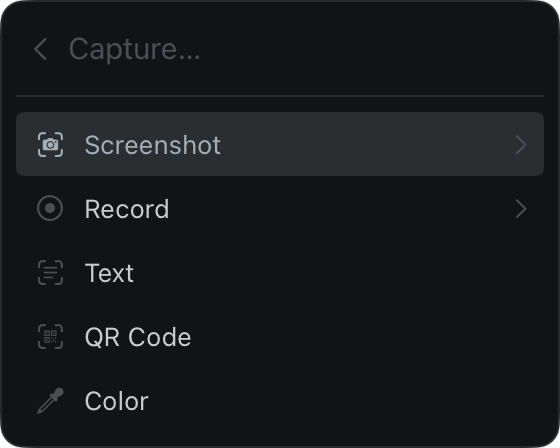

# Menu

A keyboard-driven main menu, like the Omarchy menu, opened from a snail in the bar or with ⌥⇧Space.

| Section | Rows |
| --- | --- |
| Capture | Screenshot of a region, a window or the display, saved to the Desktop and copied. Record a region, a window or the display to a `.mov` on the Desktop, the display also with the sound the Mac plays, and Stop Recording. Text and QR Code read a region and copy what they find. Color copies the colour you click as `#rrggbb`. |
| Style | Theme opens the picker of [Theme](../sndrgrdn.theme). Next Background and Previous Background change the wallpaper and keep the menu open. |
| Toggle | Stay Awake keeps the Mac and its display awake until you choose Allow Sleep. |
| System | Lock, Sleep, Log Out, Restart and Shut Down. The last three ask first. |

- ↑ and ↓ or tab move, ↵ or → opens a row, ← or ⌫ goes back, and esc closes the menu. In a confirm, ← and → choose and ↵ answers.
- A toast confirms each capture. Click it to open the file, or the link a QR code holds.
- For Region or Window, drag a region, click a window, or click the desktop for the whole display.
- Display captures and records the main display.

The plugin has three parts. The bar widget opens the menu below the snail, and the menu runs each row through the service. The service does the work, keeps the recording and Stay Awake running while the menu is closed, and publishes them as the `sndrgrdn.menu` topic: `{ recording, awake }`. `gary call sndrgrdn.menu run <command>` runs a row from a script, such as `run record-stop`, and `gary call sndrgrdn.menu state` prints the topic.

## Setup

- Use a Nerd Font for the bar, such as `JetBrainsMono Nerd Font`, as Omarchy does, so the snail shows.
- Allow Screen Recording for Gary, for the captures, Text and QR Code, and Accessibility, for Lock. The first Log Out, Restart or Shut Down asks to let Gary control loginwindow.
- Theme and the backgrounds need [Theme](../sndrgrdn.theme).

## Develop

Gary reloads the plugin each time you save an entry file. It uses Effect from `gary:effect`. Run `npm install` once at the repository root for the `effect` types, then type-check it with `npx tsc -p .`.
After you change `uses` or `subscribes` in `manifest.json`, run `gary plugin types .` to refresh `gary.d.ts`.
