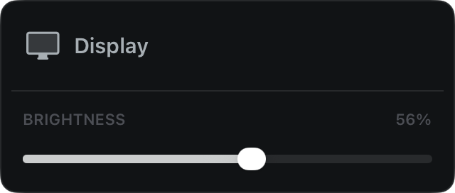

# Monitor

Shows a display icon in the bar, as Omarchy does, and opens Omarchy's monitor panel below it with a brightness slider for each display whose brightness Gary can set.



- The icon shows two screens when more than one display is connected.
- Scroll over the icon to change the brightness of the built-in display.
- Gary sets the brightness of the built-in display and of external displays that support DDC. It cannot change text size or scaling, or turn a display on or off, so the panel leaves those out.

The icon is a Nerd Font glyph, so the bar needs a Nerd Font, such as `JetBrainsMono Nerd Font`. For the pill that the brightness keys show, turn on `sndrgrdn.osd`.

## Setup

Name a Nerd Font `icon` in `~/.config/gary/theme.json`. The panel's display icon is one of its glyphs:

```json
{ "fonts": { "icon": { "family": "JetBrainsMono Nerd Font", "size": 13, "weight": "regular" } } }
```

## Install

This plugin ships in the `sndrgrdn/gary-plugins` package. Installing the package adds every plugin in it:

```sh
gary plugin install git:github.com/sndrgrdn/gary-plugins
```

To use only this plugin, turn the others off with `gary plugin disable <id>`.

## Develop

Gary reloads the plugin each time you save an entry file. It uses Effect from `gary:effect`. Run `npm install` once at the repository root for the `effect` types, then type-check it with `npx tsc -p .`.
After you change `uses` or `subscribes` in `manifest.json`, run `gary plugin types .` to refresh `gary.d.ts`.
