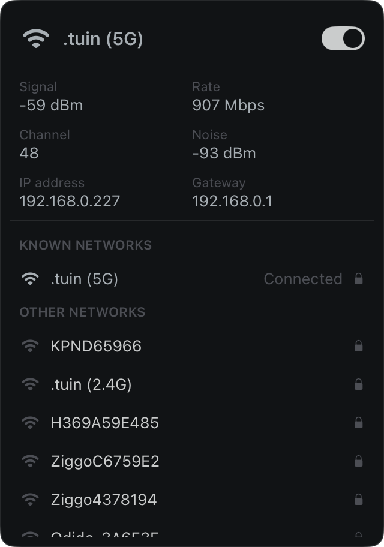
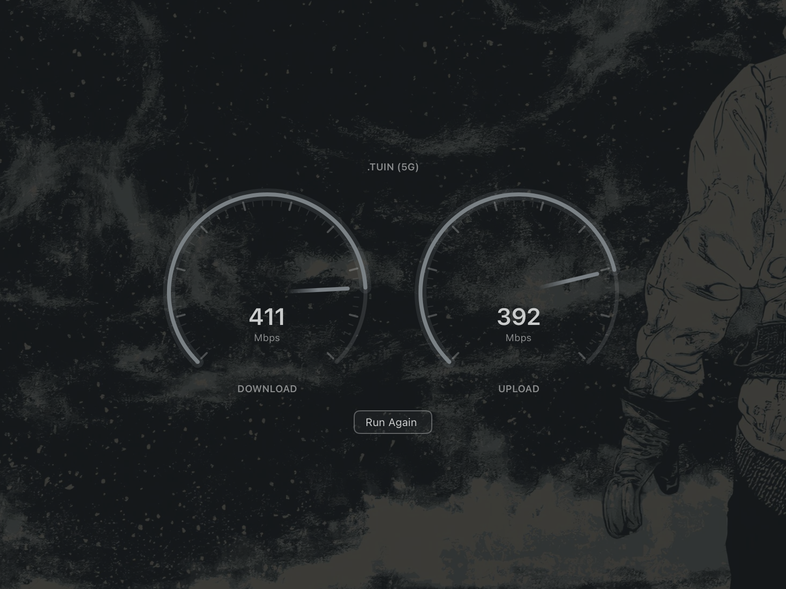

# Network

Shows Wi‑Fi in the bar with Omarchy's signal icon, and opens Omarchy's network panel below it: the network you are on with its details, and the networks nearby.



- The icon shows the signal in five steps, or Wi‑Fi off when it is off or not connected.
- The panel shows the signal, rate, channel and noise of the network you are on, with this Mac's IP address and the gateway.
- The switch turns Wi‑Fi on or off, and the gauge button next to it closes the panel and opens Omarchy's speed test.
- The speed test dims the screen and shows a download and an upload dial in Mbps, titled with the network's name. It measures the download, then the upload, with macOS's `networkQuality`, and the dials share a scale that steps up from 100 Mbps as the speed climbs. Run Again, or Return, measures again. Escape or a click outside the dials closes it and stops the test. The live dials need a Gary newer than 0.4.0, whose `host.spawn` splits `networkQuality`'s progress line at each carriage return.
- Known networks come first, then other networks, each with a lock when it needs a password. Click one to join it. If it needs a password you haven't saved, a password field opens below it.
- Right-click a known network for Forget This Network.
- Gary cannot disconnect from a network, pick the band or the DNS servers, or tell Ethernet or a captive portal apart, so the panel leaves those out.



The icon is a Nerd Font glyph, so the bar needs a Nerd Font, such as `JetBrainsMono Nerd Font`. Network names need Location. Until you allow it, the panel offers to ask for it.

## Setup

Name a Nerd Font `icon` in `~/.config/gary/theme.json`. The panel's icons are its glyphs:

```json
{ "fonts": { "icon": { "family": "JetBrainsMono Nerd Font", "size": 13, "weight": "regular" } } }
```

## Install

This plugin ships in the `sndrgrdn/gary-plugins` package. Installing the package adds every plugin in it:

```sh
gary plugin install git:github.com/sndrgrdn/gary-plugins
```

To use only this plugin, turn the others off with `gary plugin disable <id>`.

## Develop

Gary reloads the plugin each time you save an entry file. It uses Effect from `gary:effect`. Run `npm install` once at the repository root for the `effect` types, then type-check it with `npx tsc -p .`.
After you change `uses` or `subscribes` in `manifest.json`, run `gary plugin types .` to refresh `gary.d.ts`.
