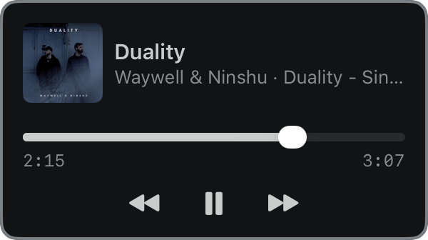

# Now Playing

Shows a music icon in the bar while media plays, and opens a panel with the artwork, a seek bar and controls when you click it. Scrolling over it changes the volume. When nothing plays, or playback pauses, the widget leaves the bar.

## Settings

Set `showTitle` to `true` in `~/.config/gary/shell.json` to show the artist and title after the icon. It is `false` by default, and the icon's tooltip always shows them:

```json
{ "settings": { "sndrgrdn.now-playing": { "showTitle": true } } }
```


