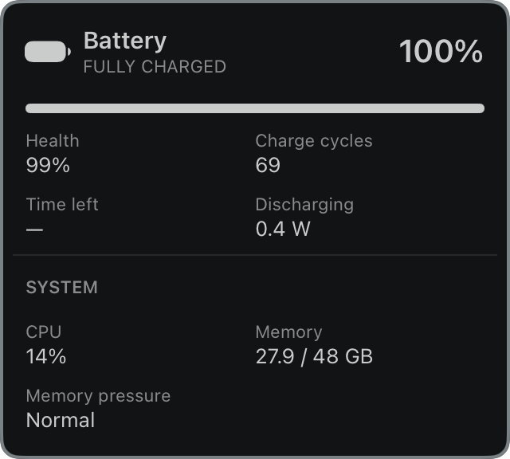

# Power

Shows the battery in the bar with Omarchy's battery icon, and opens Omarchy's power panel below it with the battery's details and the system's load.



- The icon fills in tenths, shows a bolt while the Mac charges, and turns `bad` at 20% or less on battery.
- The panel shows the battery's health, charge cycles, the time to empty or to full, and the rate it charges or drains at, from `ioreg`.
- Below them it shows CPU and memory use and memory pressure, from Gary's `system` topic.
- Changing Low Power Mode needs administrator rights, which Gary has no way to ask for, so the panel has no power profiles.
- At 10% or less on battery it posts Omarchy's notification, "Time to recharge!", with a sound, once. It warns again only after the Mac has charged, run on power, or climbed above 10%, and it remembers the warning across reloads.
- On a Mac without a battery the widget shows nothing.

The icon is a Nerd Font glyph, so the bar needs a Nerd Font, such as `JetBrainsMono Nerd Font`. The low battery warning needs Notifications for Gary.

## Settings

Set `showPercentage` to `true` in `~/.config/gary/shell.json` to show the battery's percentage after the icon in the bar. It is `false` by default, as in Omarchy, and the panel always shows it:

```json
{ "settings": { "sndrgrdn.power": { "showPercentage": true } } }
```

## Setup

Name a Nerd Font `icon` in `~/.config/gary/theme.json`. The panel's battery icon is one of its glyphs:

```json
{ "fonts": { "icon": { "family": "JetBrainsMono Nerd Font", "size": 13, "weight": "regular" } } }
```

## Install

This plugin ships in the `sndrgrdn/gary-plugins` package. Installing the package adds every plugin in it:

```sh
gary plugin install git:github.com/sndrgrdn/gary-plugins
```

To use only this plugin, turn the others off with `gary plugin disable <id>`.

## Develop

Gary reloads the plugin each time you save an entry file. It uses Effect from `gary:effect`. Run `npm install` once at the repository root for the `effect` types, then type-check it with `npx tsc -p .`.
After you change `uses` or `subscribes` in `manifest.json`, run `gary plugin types .` to refresh `gary.d.ts`.
