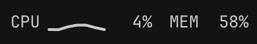

# System Load

Shows CPU use over the last 60 seconds as a sparkline in the bar, with the current CPU and memory use.



- The sparkline draws one point every 2 seconds, from 0 to 100% CPU.
- Memory counts what Activity Monitor calls Memory Used: app memory, wired memory and compressed memory.
- It shows `--%` until the first sample arrives.

The plugin has two parts. A service runs `iostat` and `vm_stat` every 2 seconds and publishes the samples as the `sndrgrdn.system-load` topic. The bar widget draws that topic. `gary call sndrgrdn.system-load state` prints the samples the service holds.

The service skips `top -l 1`, which costs about 0.4 s of CPU per sample. `iostat` waits out the 2 seconds and reports the CPU use over them, and with `vm_stat` it costs about 10 ms of CPU per sample.

## Install

This plugin ships in the `sndrgrdn/gary-plugins` package. Installing the package adds every plugin in it:

```sh
gary plugin install git:github.com/sndrgrdn/gary-plugins
```

To use only this plugin, turn the others off with `gary plugin disable <id>`.

## Develop

Gary reloads the plugin each time you save an entry file. It uses Effect from `gary:effect`. Run `npm install` once at the repository root for the `effect` types, then type-check it with `npx tsc -p .`.
After you change `uses` or `subscribes` in `manifest.json`, run `gary plugin types .` to refresh `gary.d.ts`.
