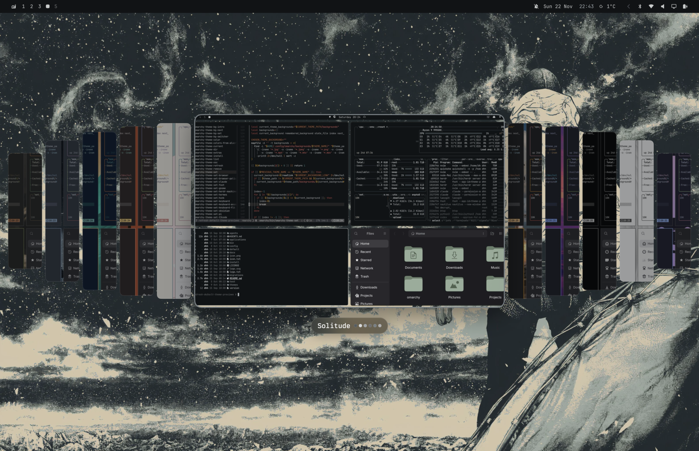

# Theme

Switches between the [Omarchy](https://github.com/basecamp/omarchy) themes with a picker, and applies the chosen theme to Gary, the wallpaper, and your apps. It is the Gary version of [theme-switcher](https://github.com/sndrgrdn/theme-switcher).



## Use

- **ctrl+alt+cmd+space** opens the picker. The selected theme's preview fills the middle, and the other themes sit on both sides.
  - Type to filter by name.
  - Left and right, or tab and shift+tab, move the selection.
  - Return applies the theme.
  - Escape clears the filter, then closes the picker.
- **ctrl+alt+shift+cmd+space** shows the theme's next wallpaper.

## What a theme changes

Applying a theme updates each of these that is installed:

- macOS light or dark mode
- the wallpaper on every display; it is put back when a workspace switch changes it
- Gary's palette, `~/.config/gary/palette.toml`, so the bar and every plugin follow it
- dinky
- Rex
- pi
- Claude Code
- OpenCode
- Herdr
- Ghostty
- Hunk
- Helium
- Cursor

The first time it changes an app's config file, it keeps a copy of the original in `~/Library/Application Support/Theme Switcher/backups`. It writes what it did to `apply.log` in the same folder.

## Themes

The plugin downloads the official Omarchy themes into `~/Library/Application Support/Theme Switcher/omarchy`. Put your own themes in `~/.config/theme-switcher/themes`, using the same layout as an Omarchy theme.

## Commands

```sh
gary call sndrgrdn.theme list                  # every theme, marking the current one
gary call sndrgrdn.theme current               # the current theme and wallpaper
gary call sndrgrdn.theme set tokyo-night       # apply a theme
gary call sndrgrdn.theme background previous   # or next
gary call sndrgrdn.theme update                # download the latest Omarchy themes
gary call sndrgrdn.theme picker                # open the picker
```

## Setup

Helium needs a privileged helper to set its colors. Install it with `theme-switcher helium setup`. Every other app needs no setup.

## Install

This plugin ships in the `sndrgrdn/gary-plugins` package. Installing the package adds every plugin in it:

```sh
gary plugin install git:github.com/sndrgrdn/gary-plugins
```

To use only this plugin, turn the others off with `gary plugin disable <id>`.

## Develop

Gary reloads the plugin each time you save an entry file. Type-check it with `npx -p typescript tsc -p .`.
After you change `uses` or `subscribes` in `manifest.json`, run `gary plugin types .` to refresh `gary.d.ts`.
