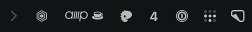

# Tray

Shows the menu bar icons of other apps, such as 1Password and Tailscale, in a drawer in the bar. Gary's bar covers the macOS menu bar, so these icons are otherwise out of sight.



- Closed, the drawer shows one chevron. Clicking it shows the icons beside it, and clicking it again hides them.
- The drawer closes by itself 5 seconds after the last click on the chevron or an icon.
- Each icon is drawn in the theme's foreground color, whatever colors the app uses.
- The chevron and each icon sit centred in a 28pt slot, the width of the bar's other icons, so the open drawer keeps their pitch. Each icon is drawn at most 12pt tall, about the size of the bar's other icons, and one wider than a slot, such as Amp's, takes two.
- Clicking an icon opens that app's own menu, and right-clicking it opens the menu the app shows on a right click. Gary briefly reveals the macOS menu bar to open it.
- Resting the pointer on an icon shows the app's description of it, or the app's name.
- It follows Gary's `tray` topic, which refreshes every 2 seconds.
- It hides Apple's own items, such as Control Center and the clock, by default.

## Permissions

It uses Gary's `tray` capability, which needs Accessibility to list and press the items, and Screen Recording to capture their icons. Grant both to Gary with `gary onboarding`. Without Accessibility the widget shows a warning icon that names the problem. Without Screen Recording it shows each app's name instead of its icon.

## Settings

`collapseAfter` is the number of seconds the drawer stays open after the last click, 5 by default.

`hide` lists the items to leave out. Each entry is the start of an item id, which is the app's bundle id followed by `#1`, `#2`, and so on. To hide dinky's workspace number and keep Apple's items out, set this in `~/.config/gary/shell.json`:

```json
{ "settings": { "sndrgrdn.tray": { "hide": ["com.apple.", "com.brnbw.dinky"] } } }
```

`gary call sndrgrdn.tray state` prints the items it shows, with their ids.

## Setup

Name a Nerd Font `icon` in `~/.config/gary/theme.json`. The warning icon is one of its glyphs:

```json
{ "fonts": { "icon": { "family": "JetBrainsMono Nerd Font", "size": 13, "weight": "regular" } } }
```

## Install

This plugin ships in the `sndrgrdn/gary-plugins` package. Installing the package adds every plugin in it:

```sh
gary plugin install git:github.com/sndrgrdn/gary-plugins
```

To use only this plugin, turn the others off with `gary plugin disable <id>`.

## Develop

Gary reloads the plugin each time you save an entry file. It uses Effect from `gary:effect`. Run `npm install` once at the repository root for the `effect` types, then type-check it with `npx tsc -p .`.
After you change `uses` or `subscribes` in `manifest.json`, run `gary plugin types .` to refresh `gary.d.ts`.
