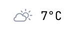

# Weather

Shows the current temperature and conditions in the bar, from [Open-Meteo](https://open-meteo.com).



- The icon follows the weather: sun, partly cloudy, cloud, fog, rain, sleet, snow or thunder.
- It shows `--°C` until the first request succeeds.
- It refreshes every 15 minutes, and 10 seconds after you unlock the Mac.
- It uses Gary's `network` capability. It needs no API key and no permissions.

## Settings

It shows Leeuwarden by default. To show another place, set its coordinates in `~/.config/gary/shell.json`:

```json
{ "settings": { "sndrgrdn.weather": { "latitude": 52.37, "longitude": 4.9 } } }
```

## Install

This plugin ships in the `sndrgrdn/gary-plugins` package. Installing the package adds every plugin in it:

```sh
gary plugin install git:github.com/sndrgrdn/gary-plugins
```

To use only this plugin, turn the others off with `gary plugin disable <id>`.

## Develop

Gary reloads the plugin each time you save an entry file. Type-check it with `npx -p typescript tsc -p .`.
After you change `uses` or `subscribes` in `manifest.json`, run `gary plugin types .` to refresh `gary.d.ts`.
